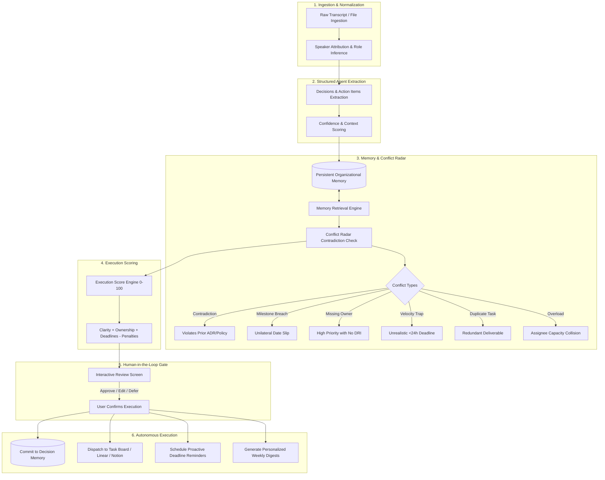

# FollowThrough ⚡

> **“Meetings create decisions. FollowThrough makes sure they get executed.”**

**FollowThrough** is an autonomous, human-in-the-loop Agentic AI platform built for the **Agentic AI Hackathon** (Problem Statement: *Meeting-to-execution agent*).

Unlike conventional meeting tools that merely generate passive summaries or chat transcripts, FollowThrough is an **execution agent**. It attributes speakers, extracts ratified decisions and actionable deliverables, cross-checks persistent organizational memory with its **Conflict Radar** to prevent contradictions and teammate overload, enforces a mandatory human confirmation gate, dispatches verified tasks into tracking systems, schedules proactive reminders, and generates personalized weekly digests.

---

## 🌟 Key Differentiators

| Standard Meeting Summarizers | FollowThrough Execution Agent |
| :--- | :--- |
| Generates walls of unverified text | Extracts strict, validated decision & task schemas |
| Zero memory of prior organizational agreements | **Persistent Decision Memory**: Indexes every approved policy across meetings |
| Unaware of contradictory commitments | **Conflict Radar**: Identifies contradictions, milestone breaches, missing DRIs, and capacity collisions |
| Blindly fires notifications or creates noise | **Human-in-the-Loop Confirmation Gate**: Mandatory review before any state change |
| Passive notes that get lost in Slack | **Task Board & Integrations**: Kanban tracking + Linear/Notion sync simulation |
| Generic meeting recap sent to everyone | **Personalized Weekly Digest**: Tailored deliverables, overdue alerts, and decision impact per person |

---

## 🏗️ System Architecture



---

## 🤖 The Multi-Step Agentic Workflow

FollowThrough executes an 8-stage agentic pipeline:

1. **Ingest & Normalize Transcript**: Cleans colloquialisms, tokenizes timestamps (`[00:45]`), and handles pasted text or `.txt`/`.md` uploads.
2. **Speaker Attribution & Persona Mapping**: Resolves conversational prefixes to organizational personas (e.g. Elena Vance → VP of Engineering, Marcus Chen → Product Lead).
3. **Structured JSON Extraction**: Employs structured schemas to extract ratified decisions, action items, assignees, deadlines, and project risks.
4. **Organizational Memory Query**: Queries historical decisions stored across past meetings to retrieve relevant baseline commitments.
5. **Conflict Radar Analysis**: Cross-references new proposals with historical memory to detect:
   - **`CONTRADICTION`**: Reversing ratified policies (e.g. dropping iOS 15 support when ADR-24 mandated backward compatibility).
   - **`CHANGED_COMMITMENT`**: Shifting public release milestones without stakeholder consensus.
   - **`MISSING_OWNER`**: Critical tasks left unassigned or assigned vaguely to "the team".
   - **`UNREALISTIC_DEADLINE`**: Massive architectural overhauls scheduled in `<24h`.
   - **`DUPLICATE_TASK`**: Spawning redundant deliverables already tracked in open sprints.
   - **`DEADLINE_CONFLICT`**: Assigning multiple concurrent high-stakes deliverables to one teammate.
6. **Execution Score Calculation**: Assigns a transparent 0–100 score based on Decision Clarity (25), Ownership Coverage (25), Deadline Precision (25), and Risk Deductions.
7. **Human Confirmation Gate**: Staged actions are reviewed on an approval screen. **No external tasks or memories are created without explicit confirmation**.
8. **Autonomous Dispatch**: Commits approved decisions to long-term memory, creates tasks on the Kanban board, schedules deadline reminders, and updates personal weekly digests.

---

## 💻 Tech Stack

- **Framework**: Next.js 14+ (App Router, Server Components & Route Handlers)
- **Language**: TypeScript (strict type safety)
- **Styling**: Tailwind CSS with dark-mode SaaS styling and custom glowing accents
- **Icons**: Lucide React
- **Persistence**: File-backed ACID JSON database (`data/database.json`) with automatic directory creation and atomic file operations
- **AI Engine**: Hybrid Dual-Engine:
  - **Live LLM Mode**: Google Gemini 1.5 Flash (`@google/generative-ai`) with structured JSON schema output
  - **Deterministic Heuristic Engine**: Zero-API-key instant demo fallback so judges never hit rate limits or setup friction

---

## 🚀 Quickstart & Setup Instructions

### Prerequisites
- Node.js 18+ (tested on Node v20 & v26)
- npm or yarn

### 1. Clone & Install
```bash
git clone <repository-url>
cd followthrough
npm install
```

### 2. Seed Database
Initialize the persistent database with baseline organizational ADRs and historical meetings:
```bash
node scripts/seed.mjs
```

### 3. Optional: Configure Gemini API Key
To use the live Gemini 1.5 Flash LLM for extraction, create a `.env.local` file:
```env
GEMINI_API_KEY=your_gemini_api_key_here
```
*(Note: If no API key is provided, FollowThrough automatically uses its deterministic heuristic engine to deliver 100% feature functionality during demos).*

### 4. Run Development Server
```bash
npm run dev
```
Open **[http://localhost:3000](http://localhost:3000)** in your browser.

---

## 🧪 Interactive Demo Guide (3 Scenarios)

FollowThrough comes with 3 pre-configured demo transcripts accessible right from the UI:

### Scenario 1: Q3 Mobile App Launch Sync (Direct Contradiction)
- **Click**: Dashboard → **"Load & Run Scenario"** on Sample 1
- **What Happens**:
  - The agent identifies a **CRITICAL CONTRADICTION**: The meeting decides to *"Drop iOS 15 support"*, directly violating ratified **ADR-24** in organizational memory (*"Mobile v2.0 must maintain iOS 15+ compatibility for 28% of enterprise customers"*).
  - The agent flags another **CRITICAL VIOLATION**: Attempting to switch the auth provider to Auth0 without an architectural review.
  - The **Conflict Radar** shows a side-by-side comparison with the prior decision, date, and owner.
  - The user can reject the contradictory decision, approve the safe tasks, and click **"Confirm & Execute"**.

### Scenario 2: Core Platform Sprint 42 Planning (Missing Owners & Unrealistic Deadlines)
- **Click**: Ingestion Studio → Sample 2
- **What Happens**:
  - The agent detects a **MISSING OWNER** on a critical Redis payment service overhaul.
  - The agent detects an **UNREALISTIC DEADLINE**: Tasking Sam Torres to refactor 40 GraphQL endpoints in `<18h`.
  - The Execution Score drops to highlight organizational execution risk.

### Scenario 3: Weekly Ops & Growth Review (Duplicate Tasks & Overload)
- **Click**: Ingestion Studio → Sample 3
- **What Happens**:
  - Flags a **DUPLICATE TASK** (Attribution tracking pixel already assigned to Carlos in `MKT-89`).
  - Detects **ASSIGNEE OVERLOAD**: Carlos Mendes assigned 3 concurrent high-stakes deliverables on the same Friday.
  - Detects a violation of the active Google Ads spend freeze policy.

---

## 🗺️ Future Roadmap

- [ ] **Native Slack & Zoom Bots**: Real-time webhook ingestion directly from Zoom cloud recording webhooks and Google Meet bots.
- [ ] **Two-Way Linear & Jira Sync**: Bidirectional sync syncing status updates back to meeting records when PRs merge.
- [ ] **Voice Attribution Diarization**: Multi-modal audio diarization directly from raw MP3/WAV recordings.
- [ ] **Predictive Capacity Modeling**: LLM-driven velocity forecasting based on historical sprint burndown data.

---

## 🤝 Human Contribution vs. AI Generation

| Component | Architecture & Human Engineering | AI Agent Autonomous Generation |
| :--- | :--- | :--- |
| **System Design** | Architecture planning, entity relationships, conflict taxonomy | Dynamic pipeline orchestration |
| **Conflict Radar** | 6-class conflict heuristics, severity rules, memory retrieval | Semantic contradiction detection & contextual explanations |
| **Safety & Governance**| Mandatory confirmation gatekeeper, rejection overrides | Proposed task generation & draft scheduling |
| **User Experience** | Responsive dark-mode UI, Kanban board, Per-person digest view | Dynamic summary generation, speaker persona inference |
